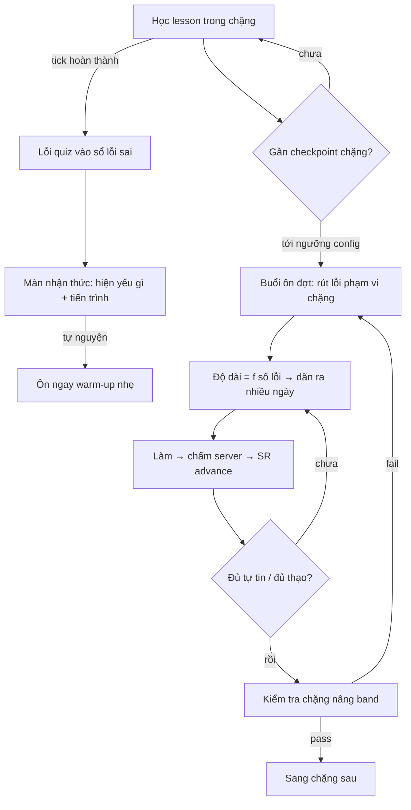

# Spec (Overview): Sổ lỗi sai — Ôn neo checkpoint & buổi ôn linh hoạt (Phase 3+)

- **Ngày:** 2026-08-13
- **Tác giả:** AI + Dev (thảo luận trực tiếp)
- **Trạng thái:** Nháp tổng quan — chờ chốt các quyết định §7
- **Tiền thân:** `specs/mistake-review-layer` (P1 · data layer), `specs/mistake-review-ui` (P2 · UI + REST). Đã merge/đang PR.
- **Liên quan:** `specs/course-checkpoints-band-up` (checkpoint chặng), `specs/study-schedule-generation` (lịch học · `buildReviewDay`), PRD-119 (M4-9 ôn tập), PRD-120 (M4-10 remediation).
- **Mục đích tài liệu:** cho một **góc nhìn tổng quan** để hoàn thiện chức năng sổ lỗi sai trong một khóa nâng band. Nếu quá tải → tách theo §8.

---

## 1. Mục tiêu

Chuyển "ôn tập" từ **lịch tuần cứng** sang **neo vào checkpoint chặng**, với **buổi ôn co giãn theo lượng lỗi thực tế**. Sổ lỗi sai đóng **2 vai trò tách bạch**:
1. **Màn nhận thức (luôn hiện):** cho học viên thấy "đang yếu gì / thiếu gì".
2. **Nguồn cho buổi ôn trước kiểm tra chặng:** nơi sổ lỗi sai thực sự hiệu quả — ôn trúng chỗ yếu ngay trước cổng nâng band.

Không ép "1 tuần ôn 1 lần"; buổi ôn **linh hoạt tối đa** về thời điểm & độ dài.

## 2. Bối cảnh (đã kiểm code + dữ liệu thật, không đoán)

- **P1/P2 đã có:** collection `review_schedule` (Leitner `[1,3,7,14,30]`), REST `/api/review` (items/session/answer), UI `/practice/review`. Session **chỉ phục vụ câu trong sổ, đến hạn, standalone** (đã fix bank-only). Chấm **server-side**.
- **Checkpoint chặng đã có sẵn:** `course-content.model.js` — `checkpoint` (CheckpointRefSchema, `passThreshold`) gắn ở **ranh giới từng phase (chặng)** và **cuối khóa**.
- **Ôn hiện tại = tuần theo lịch:** `lesson-schedule.generator.js → buildReviewDay(weekLessons)` chèn 1 ngày ôn theo `reviewDow`, gom *toàn bộ bài trong tuần* — **không** bám mistake bank, **không** bám checkpoint.
- **Dữ liệu thật (4 khóa IELTS published):**
  - **3 chặng/khóa**, đồng đều: chặng 3–4 module · 6–8 lesson.
  - **Exercises gần như rỗng** (0–2 cả khóa); chỉ khóa `ielts-3-5-5-0-nen-tang` (đang `ready`) có quiz 1/2/2 + checkpoint cả 3 chặng.
  - `estimatedDurationMin` = 0 khắp nơi → **đo buổi ôn bằng số câu, không bằng phút**.
  - Schema `phases[]` import từ xlsx → **số/độ dài chặng do dữ liệu quyết định** (khả năng co giãn CÓ, nhưng dữ liệu hiện tại là template cứng).
- **Nguồn lỗi:** chỉ `learning_events source:'quiz', correct:false` (quiz bài học). Item tag `skill/subskill` trong `assessment_questions`. Phân bố subskill (standalone active): `use_of_english` inference 213 · grammar_tense 28 · collocation 20 · word_form 12; reading/listening 4–25/subskill.

## 3. Nguyên tắc thiết kế

1. **Bank = nhận thức, không ép cadence.** Luôn hiện "yếu gì"; nút "ôn ngay" tự nguyện.
2. **Ôn thật = neo checkpoint, độ dài = f(số lỗi).** Ít lỗi → ngắn / báo "ổn"; nhiều lỗi → dãn nhiều ngày / chia nhỏ trước checkpoint.
3. **Facade — không merge dữ liệu.** Mỗi loại giữ engine riêng: từ vựng `FlashcardSrs`, IPA `ipa_srs_queue`, ngữ pháp/kỹ năng `review_schedule`. Hub chỉ điều phối & đếm.
4. **Exact-repeat chỉ cho subskill dạng cố định.** Subskill áp dụng → `deferred` (ghi nhận, chưa cho ôn) tới khi có engine biến tấu.
5. **Admin config trong khóa.** Checkpoint + chính sách ôn (mấy ngày trước, độ dài tối thiểu, warm-up) cấu hình theo khóa/chặng — tiền đề bắt buộc.

## 4. Phạm vi

### 4.1 Trong phạm vi (làm để hoàn thiện)

| # | Hạng mục | Ghi chú |
|---|---|---|
| A | **Màn nhận thức**: bank hiện "yếu gì" theo skill/subskill + **tiến trình** (box "còn N lần để thạo", đến hạn/còn X ngày/đã thạo) | Mở rộng list P2 |
| B | **Facade hub** gom 2 nguồn ôn-lại-đúng-câu: **từ vựng** (surface `GET /flashcards/weak` → mở runner thẻ sẵn có) + **ngữ pháp dạng cố định** (`review_schedule` item-mode) | Không kéo thẻ vào `review_schedule` |
| D | **Buổi ôn neo checkpoint**: rút lỗi phạm vi chặng (+ câu SRS đến hạn), **co giãn theo số lỗi**, **dãn ra nhiều ngày** trước checkpoint | Đo bằng số câu |
| F | **Admin config**: checkpoint + review policy theo chặng (days-before, min size, warm-up on/off) | Tiền đề dữ liệu |

### 4.2 Ngoài phạm vi (note để xem xét — tách nếu quá tải)

| Hạng mục | Lý do |
|---|---|
| **Kỹ năng áp dụng — engine "câu biến tấu"** (concept-mode, rút câu khác cùng subskill) | Cần bộ chọn variant + pool đủ lớn; bật khi dữ liệu đủ (§7.1) |
| **"Làm thử như thi"** trước checkpoint (trộn câu cả chặng, tính giờ) | Enhancement; phase sau (§7.2) |
| **IPA gộp vào hub** | Giữ `ipa_srs_queue` chạy riêng; chưa động vào |
| **Writing / Speaking** | Cần chấm AI qua `llm`, không phải session objective |
| **Rewire `buildReviewDay`/generator** | Vùng lịch học M4-9 (PRD-119) — **phối hợp**, không viết đè |
| **Tác giả nội dung (nhập exercises)** | Data readiness, không phải scope code |

## 5. User story

| Actor | Muốn | Để |
|---|---|---|
| Learner | Thấy rõ mình đang yếu gì, còn bao xa mới thạo | Biết cần ôn gì, không mò |
| Learner | Trước kiểm tra chặng, ôn trúng lỗi của chặng (dãn được vài ngày) | Nâng band chắc hơn, không nhồi 1 buổi |
| Admin | Cấu hình checkpoint + buổi ôn cho từng chặng của khóa | Buổi ôn khớp nội dung thực tế của khóa |
| M4-9 (lịch) | Gọi service lấy "đợt ôn trước checkpoint của user X" | Chèn buổi ôn thông minh thay ôn-tuần-cứng |

## 6. Luồng chính

## 7. Quyết định

### Đã chốt (2026-08-13)

**7.1 — Ôn lại đúng câu cho TẤT CẢ lỗi objective (bây giờ).** Khi chưa đủ dữ liệu cho "câu biến tấu" thì thà ôn lại đúng câu còn hơn không ôn. → grammar_tense, collocation, word_form, inference… đều **exact-repeat**. Chỉ defer thật sự: **testlet** (đã defer) + **writing/speaking** (cần AI). "Câu biến tấu" (concept-mode) → **parked**, chỉ bật khi ngân hàng câu đủ lớn. Hệ quả: **không cần config `REVIEW_MODE_BY_SUBSKILL` ở giai đoạn này**.

**7.2 — "Progressive reveal" là hành vi TỰ ĐỘNG, không phải hạng mục code.** Mỗi lần nộp quiz sai, câu tự vào sổ (`enqueueMistakes`) → "tick tới đâu lộ lỗi tới đó" vốn đã chạy. Phần *thật sự mới* là chế độ **"làm thử như thi"** (trộn câu cả chặng, có thể tính giờ) trước checkpoint → **để phase sau** (mặc định, trừ khi dev đổi ý).

**7.3 — BỎ "warm-up giữa 2 chặng".** Thừa: **sổ lỗi sai luôn mở** → học viên tự bấm "ôn ngay" bất cứ lúc nào, đó chính là warm-up on-demand. Chỉ còn 2 thứ: (1) sổ luôn mở (tự nguyện) + (2) buổi ôn nhắc trước checkpoint (goal-aligned).

### Còn mở (cho Phase 3c/3d)

**7.4 Cách dãn buổi ôn:** ngưỡng kích hoạt (mấy ngày/bao nhiêu % chặng trước checkpoint) + cách chia nhiều ngày → **admin config** hay default hệ thống?

**7.5 Khóa CHƯA có checkpoint** (mọi khóa published hiện tại): nếu chặng không có checkpoint → không có buổi ôn neo, chỉ còn sổ nhận thức (tự nguyện).

## 8. Phân phase (tách khi quá tải)

| Phase | Nội dung | Phụ thuộc |
|---|---|---|
| **3a** | Nhận thức + tiến trình (A) + config mapping (C) | Chỉ dựa P1/P2 — nhỏ, làm ngay được |
| **3b** | Facade hub + surface từ vựng (B) | `GET /flashcards/weak` (có sẵn) |
| **3c** | Buổi ôn neo checkpoint + progressive reveal (D, E) | Cần checkpoint config; phối hợp M4-9 |
| **3d** | Admin config checkpoint + review policy (F) | exe-admin + course-content |
| **Parked** | Variant engine · IPA · Writing/Speaking | Xem xét sau |

## 9. Rủi ro & phụ thuộc

- **Data readiness (chặn lớn nhất):** khóa published chưa có checkpoint + exercises gần rỗng → feature "chạy khan" tới khi nội dung được nhập. 3a/3b không phụ thuộc; 3c/3d phụ thuộc mạnh.
- **Phối hợp M4-9:** `buildReviewDay` là vùng lịch học của owner khác — đổi trigger cần thống nhất.
- **Độ dài chặng biến thiên:** không cố định "1 buổi = 1 chặng"; buổi ôn phải adaptive theo số câu.

## 10. Open questions

- 7.1–7.5 ở trên.
- Định nghĩa "đủ thạo để thi chặng" — theo % câu đã ôn đạt, hay theo SR box tối thiểu?
- Warm-up nhẹ có tính vào streak/gamification không?
